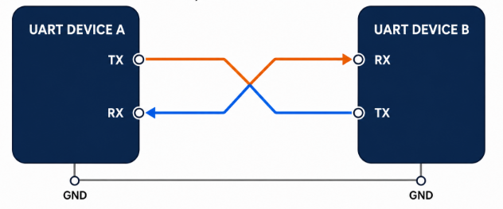
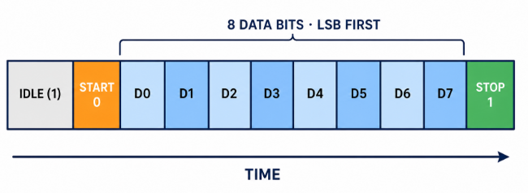
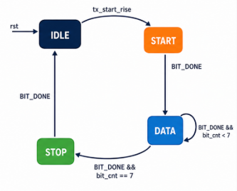
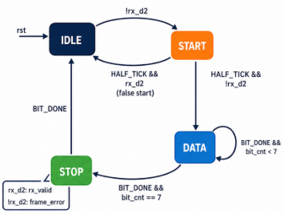

# UART IP Core

[](rtl/)
[](#uart-frame)
[](docs/README.md)
[](LICENSE)

A compact, synthesizable UART core written in Verilog for learning digital
design, serial communication, finite-state machines, and RTL verification.
The project implements a complete transmit/receive path, a programmable baud
generator, a small register-controlled top level, and self-checking
testbenches.

<p align="center">
  
</p>

## Overview

UART (Universal Asynchronous Receiver/Transmitter) transfers serial data
without a shared clock. Both endpoints agree on the baud rate and frame format
before communication. A full-duplex connection uses two crossed data lines:
the TX output of each device connects to the RX input of the other device.

This repository focuses on a readable educational implementation rather than
a vendor-specific or production-ready peripheral. The design is split into
small RTL modules so that baud generation, transmission, reception, and
top-level integration can be studied and verified independently.

### Implemented Configuration

| Property | Implementation |
|---|---|
| Frame format | 8N1 |
| Data width | 8 bits |
| Bit order | Least-significant bit first |
| Parity | None |
| Stop bits | 1 |
| Idle level | Logic HIGH |
| Timing | 16× oversampling tick |
| RX input handling | Two-flop synchronizer |

## UART Frame

<p align="center">
  
</p>

A UART frame can support different data widths, parity modes, and stop-bit
counts. This core deliberately selects the common **8N1** configuration: one
LOW start bit, eight data bits, no parity, and one HIGH stop bit.

```text
Idle(1) | Start(0) | D0 D1 D2 D3 D4 D5 D6 D7 | Stop(1)
```

The receiver validates the start bit near its midpoint, samples each data bit
at 16-tick intervals, and accepts the byte only after checking the stop bit.

## Architecture

```text
                         +----------------+
 BAUD_DATA ------------> | UART baud gen  | ---- 16× baud tick ----+
                         +----------------+                         |
                                                                    |
 TX_DATA / tx_start ---> +----------------+                         |
                         | UART TX        | <-----------------------+
                         | serializer     | -------- tx             |
                         +----------------+                         |
                                                                    |
 RX_DATA / rx_valid <--- +----------------+                         |
                         | UART RX        | <-------- rx             |
                         | deserializer   | <-----------------------+
                         +----------------+

              uart_top: register interface, enable, and sticky status
```

### RTL Modules

| Module | Responsibility |
|---|---|
| [`uart_baud_gen`](rtl/uart_baud_gen.v) | Generates the one-clock 16× oversampling tick from a programmable divider |
| [`uart_tx`](rtl/uart_tx.v) | Serializes an 8-bit value into an 8N1 frame and reports `tx_busy` |
| [`uart_rx`](rtl/uart_rx.v) | Synchronizes RX, validates the start bit, reconstructs data, and detects an invalid stop bit |
| [`uart_top`](rtl/uart_top.v) | Integrates the UART cores behind a small educational register interface |

### TX and RX State Machines

<table>
  <tr>
    <th align="center">TX FSM</th>
    <th align="center">RX FSM</th>
  </tr>
  <tr>
    <td align="center"></td>
    <td align="center"></td>
  </tr>
</table>

Both protocol engines use the same four-state sequence:

```text
IDLE -> START -> DATA -> STOP -> IDLE
```

- TX accepts `tx_start_rise`, holds each frame section for 16 baud ticks, and
  shifts eight data bits before returning to IDLE after the stop bit.
- RX detects a LOW input, validates the start bit at `HALF_TICK`, samples eight
  data bits, and accepts or rejects the frame after checking the stop bit.

In the diagrams, `BIT_DONE` means `baud_tick && (bit_tick_cnt == 15)`, while
`HALF_TICK` means `baud_tick && (bit_tick_cnt == 7)`.

## Key Features

- Synthesizable Verilog RTL with synchronous active-HIGH reset.
- Fixed 8N1 framing with LSB-first serialization.
- Programmable baud divider shared by TX and RX.
- 16× timing for start-bit validation and receive sampling.
- Two-flop synchronizer on the asynchronous RX input.
- One-cycle `rx_valid` and framing-error events.
- Sticky receive-ready and framing-error status at the top level.
- Protection against overwriting an active TX frame.
- Registered TX pin and a one-byte RX buffer with sticky overrun detection.
- Module-level and end-to-end loopback verification.
- Repeatable command-line and QuestaSim waveform flows.

## Register Interface

`uart_top` exposes a deliberately small 2-bit address and 32-bit data
interface. It is intended to demonstrate peripheral integration and is not an
APB, AXI, or Wishbone interface.

| Address | Register | Access | Description |
|---:|---|---|---|
| `0` | `BAUD_DATA` | Read/write | 16× oversampling divider |
| `1` | `STATUS/ENABLE` | Read/write | Write bit 0 to enable the UART; read control and status |
| `2` | `TX_DATA` | Read/write | Write bits `[7:0]` to transmit; writes are ignored while disabled or busy |
| `3` | `RX_DATA` | Read | Read the buffered byte in bits `[7:0]`; clears ready unless a new byte arrives on the same edge |

Status bits returned from address `1`:

| Bit | Name | Meaning |
|---:|---|---|
| `0` | `enable` | UART enable state |
| `1` | `tx_busy` | A transmit request is pending or a frame is in progress |
| `2` | `rx_ready` | A valid received byte is available; sticky until `RX_DATA` is read |
| `3` | `frame_error_sticky` | An invalid stop bit was detected; sticky until status is read |
| `4` | `overrun_sticky` | A valid byte was discarded because the RX buffer was full; sticky until status is read |

The interface uses register indices, not byte addresses. With inputs stable
around a rising clock edge, `we` performs one write and `re` performs one read;
registered `read_data` is available after that edge. Each asserted edge counts
as an access, including the clear-on-read effects. Read bits `[31:5]` of STATUS
and `[31:8]` of RX_DATA are zero.

When the RX buffer is full, the old unread byte is retained and a new valid
byte is discarded with overrun set. If RX_DATA is read on the same edge that
the top accepts a new byte, the read returns the old byte, the buffer retains
the new byte, and ready remains set without overrun. Invalid-stop frames
leave the last good RX-core output and the top-level buffer unchanged.
Reading STATUS returns the existing flags and clears them; a simultaneous
new error takes priority over clearing and remains visible on the next read.
Reading RX_DATA while ready is zero does not provide a new valid byte.

TX writes while busy are ignored and are not queued. Software must wait for
busy to clear before writing another byte. The registered TX waveform follows
the TX state and datapath by one system clock; core busy follows the FSM.
The free-running baud tick can shorten the start bit by up to one oversampling
tick relative to the nominal bit period.

Disabling the UART synchronously resets the TX/RX cores, aborts any partial
frame, and clears the RX buffer, ready, and sticky error flags.

## Baud-Rate Programming

The baud generator creates the 16× tick used by both protocol engines:

```text
baud_division = clock_frequency / (baud_rate × 16)
```

For example, select an integer divider appropriate for the system clock and
target baud rate, write it to `BAUD_DATA`, and then set the enable bit. A
divider value of zero disables tick generation.

## Project Structure

```text
uart-ip-core/
├── rtl/
│   ├── uart_baud_gen.v
│   ├── uart_tx.v
│   ├── uart_rx.v
│   └── uart_top.v
├── testbench/
│   ├── uart_baud_gen_tb.v
│   ├── uart_tx_tb.v
│   ├── uart_rx_tb.v
│   ├── uart_top_tb.v
│   └── uart_regression_tb.v
├── sim/
│   ├── Makefile
│   └── wave.do
├── docs/
│   ├── README.md
│   ├── bug_log.md
│   └── images/
├── LICENSE
└── README.md
```

## Quick Start

### Requirements

- GNU Make
- QuestaSim commands `vlib`, `vlog`, and `vsim` available in `PATH`

### Run the Complete Test Suite

```sh
git clone https://github.com/vohoangnguyennnn/uart-ip-core.git
cd uart-ip-core/sim
make test
```

The target runs all five self-checking testbenches and stops with a non-zero
exit code if compilation fails, an assertion fires, or a watchdog timeout is
reached.

### Run One Testbench

```sh
make TB=uart_tx_tb
make TB=uart_rx_tb
make TB=uart_top_tb
make TB=uart_regression_tb
```

Running `make` without a `TB` override selects `uart_baud_gen_tb`.

### Open the Waveform GUI

```sh
make wave TB=uart_top_tb
```

The testbenches are also compatible with Icarus Verilog, and the synthesizable
RTL has been checked with Verilator lint. QuestaSim remains the documented
primary flow because `wave.do` provides grouped internal signals for protocol
inspection.

## Verification Coverage

The directed self-checking suite covers:

- Baud-generator enable, zero-divider, divider timing, and phase restart.
- TX serialization of alternating, all-LOW, and all-HIGH data patterns.
- RX valid frames, false-start rejection, and framing-error detection.
- Register read/write behavior and sticky status flags.
- End-to-end TX-to-RX loopback through `uart_top`.
- Rejection of a TX-data write while a frame is active.
- Back-to-back TX writes and preservation of good RX data after a bad stop bit.
- RX overrun, simultaneous read/arrival, error set-over-clear, and disable recovery.

Root causes and fixes are recorded in [the bug log](docs/bug_log.md).

Detailed evidence is kept outside this overview so the project landing page
remains concise:

**[Open the UART Simulation and Verification Report →](docs/README.md)**

## License

This project is released under the [MIT License](LICENSE).
